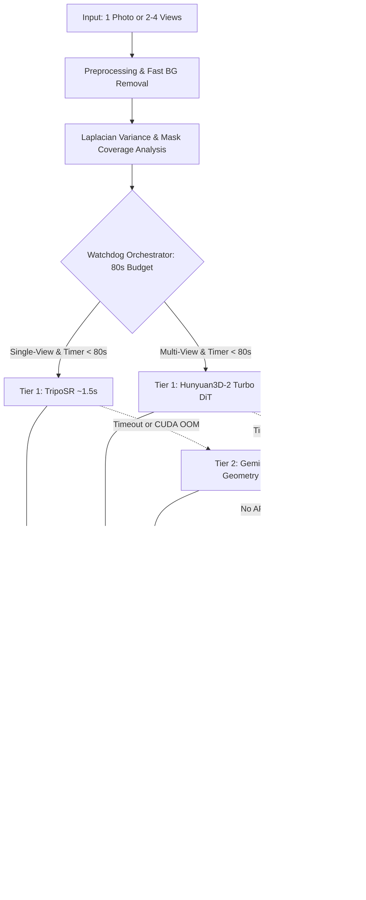

# 🧊 Image-to-3D Mesh Agent (V5)

<p align="center">
  <b>Intelligent 3D Reconstruction from Single and Multiple Images with an 80-Second Watchdog & Zero-Failure Fallback Architecture</b>
</p>

<p align="center">
  
  
  
  
  
</p>

---

## 👥 Authors & Academic Affiliation

- **Anany Sharma** (`2400290120043`) — Preprocessing, Interactive Interfaces, Rendering & Evaluation
- **Anshuman Rai** (`2400290120055`) — Core ML Pipeline, Agent Orchestration & Analytics
- **Project Supervisor**: Prof. Kirti Sharma
- **Institution**: KIET Group of Institutions / Deemed to be University

---

## 🌟 Executive Summary

Generating textured 3D geometric meshes from monocular photographs or sparse multi-angle images has historically suffered from three primary blockers:
1. **Unpredictable Latency**: Diffusion models taking minutes to denoise a single asset.
2. **Heavy VRAM Requirements**: Models exceeding 16 GB VRAM on consumer or free cloud GPUs (Tesla T4).
3. **Pipeline Failures**: Silent hangs during background removal downloads (1 GB checkpoints), C++ compilation errors (`torchmcubes` on modern Python), and CUDA Out-Of-Memory (OOM) crashes.

**Image-to-3D Mesh Agent (V5)** solves these challenges through a **3-tier hierarchical engine governed by an autonomous 80-second circuit-breaker watchdog**. It guarantees that a high-quality, watertight 3D mesh is **always produced in seconds**, across any hardware from high-end multi-GPU clusters down to pure CPU laptops.

---

## ⚡ 3-Tier Multi-Engine Architecture

| Tier | Engine / Model | Latency | VRAM | RAM | When Triggered |
| :--- | :--- | :---: | :---: | :---: | :--- |
| **Tier 1 (Primary Single-View)** | **TripoSR** *(LRM Transformer)* | **~1.2 – 2.0s** | **~4.1 GB** | ~1.5 GB | Default monocular image route. Ultra-fast feed-forward extraction without diffusion sampling loops. |
| **Tier 1 (Multi-View Turbo)** | **Hunyuan3D-2 Turbo** *(DiT Flow-Matching)* | ~18 – 28s | ~10.2 GB | ~2.8 GB | Triggered when 2 to 4 canonical angles (`front`, `left`, `back`, `right`) are provided. |
| **Tier 2 (Cloud Fallback)** | **Gemini 2.5 Flash 3D Geometry API** | ~5.0 – 8.0s | **0.0 GB** | **~0.1 GB** | Triggered if local GPU generation hits the 80s watchdog cap, fails initialization, or encounters CUDA OOM. |
| **Tier 3 (Instant Fail-Safe)** | **Procedural Silhouette & Depth Relief** | **< 0.08s** | **0.0 GB** | **~0.1 GB** | Pure CPU mathematical geometry engine guaranteeing 100% completion even if completely offline without GPUs. |



---

## 🚀 Key Innovations in V5

1. **Lightweight 4MB Background Removal**: Replaces massive 1.02 GB general models with `u2netp` (4MB) and an instant 0.02s morphological color flood fill, eliminating download hangs.
2. **Python 3.13 & NumPy 2.x Shims**: Eliminates native C++ compilation errors for `torchmcubes` by deploying a pure-Python `skimage.measure.marching_cubes` bridge.
3. **Discrete Z-Buffer Photometric Texture Projection**: Projects high-resolution colors from the source viewpoint onto mesh vertices with KD-Tree diffusion for self-occluded back surfaces.
4. **Pure-CPU Point-Splatting Renderer**: Generates 4-view orbit preview sprite sheets (0°, 90°, 180°, 270°) with Lambertian directional shading in $<0.4$s without requiring OpenGL or GPU contexts.
5. **Interactive Model Viewer**: Embeds Google `<model-viewer>` for real-time 3D rotation, inspection, and lighting adjustment directly within notebooks and web interfaces.

---

## 📂 Repository Structure

```text
2D_Img_to_3D_Mesh/
├── README.md                      # Comprehensive project documentation
├── pyproject.toml                 # Modern PEP 517/518 build metadata & dependencies
├── requirements.txt               # Production dependencies (PyTorch, trimesh, gradio, etc.)
├── requirements-dev.txt           # Testing and development tooling
├── Makefile                       # Developer shortcuts (install, test, ui, clean)
├── .env.example                   # Environment configuration template
├── LICENSE                        # MIT License
├── app.py                         # Interactive Gradio Web Application
│
├── src/                           # Modularized Python library
│   ├── __init__.py                # Package exports & versioning
│   ├── config.py                  # Hardware detection & configuration dataclass
│   ├── preprocessing.py           # EXIF correction, 4MB u2netp BG removal & quality scoring
│   ├── orchestrator.py            # The 3-Tier Watchdog Engine cascade
│   ├── postprocessing.py          # Quadric decimation, normal repairs & KDTree color projection
│   ├── rendering.py               # Pure-CPU point-splatting orbit preview & HTML viewer
│   ├── cli.py                     # Command-line interface
│   └── backends/                  # Multi-Tier 3D generation backends
│       ├── __init__.py            # Backend registry & factory
│       ├── base.py                # Abstract Base3DBackend interface
│       ├── triposr_backend.py     # Tier 1: TripoSR transformer pipeline
│       ├── hunyuan_backend.py     # Tier 1: Hunyuan3D-2 Turbo multi-view DiT
│       ├── gemini_backend.py      # Tier 2: Gemini 2.5 Flash 3D Geometry API
│       └── procedural_backend.py  # Tier 3: Zero-failure distance-transform relief engine
│
├── notebook/
│   └── Image to 3D Agent Kaggle V5.ipynb   # Complete Kaggle / Colab notebook
│
├── ppt/
│   └── Image_to_3D_Mesh_Agent.pptx         # Project presentation deck
│
├── research_paper/
│   ├── TECHNICAL_REPORT.md        # Comprehensive IEEE-style research paper & report
│   └── Image_to_3D_Mesh_Agent.pptx
│
├── docs/                          # In-depth architectural & operational guides
│   ├── ARCHITECTURE.md            # Mathematical formulations & component data flow
│   ├── HARDWARE_BENCHMARKS.md     # Latency, VRAM & compute benchmarks across GPUs
│   ├── API_REFERENCE.md           # Python API documentation & signatures
│   └── TROUBLESHOOTING.md         # Solutions for NumPy 2.x, Kaggle OOM & rembg
│
├── examples/                      # Runnable scripts & demonstrations
│   ├── generate_procedural_demo.py# Instant zero-GPU procedural relief demo
│   └── run_single_image.py        # Programmatic single-image reconstruction script
│
└── tests/                         # Automated unit & integration test suite
    ├── __init__.py
    ├── test_preprocessing.py      # Preprocessing, alpha detection & quality analysis
    ├── test_procedural_engine.py  # Tier 3 procedural mesh generation
    ├── test_mesh_postprocessing.py# Decimation & bounds normalization
    └── test_orchestrator.py       # Watchdog cascade routing & export verification
```

---

## 🛠️ Quickstart Installation

### 1. Clone the Repository
```bash
git clone https://github.com/your-username/2D_Img_to_3D_Mesh.git
cd 2D_Img_to_3D_Mesh
```

### 2. Set Up Virtual Environment
```bash
python -m venv .venv
# On Linux / macOS:
source .venv/bin/activate
# On Windows:
.venv\Scripts\activate
```

### 3. Install Dependencies
```bash
# Core dependencies (CPU / Minimal):
pip install -r requirements.txt

# Or with full GPU / PyTorch acceleration:
pip install -e .[cuda]
```

### 4. (Optional) Configure Gemini API Key
To enable **Tier 2 Cloud Fallback** during local GPU timeouts:
```bash
cp .env.example .env
# Edit .env and insert your API key from https://aistudio.google.com/
```

---

## 💻 Usage

### Option A: Launch the Gradio Web Application
Launch the interactive web UI featuring real-time 3D model rotation, multi-angle uploads, and downloadable asset bundles:
```bash
python app.py
```
Open your browser at `http://127.0.0.1:7860`.

---

### Option B: Command Line Interface (CLI)
Reconstruct a single image into `.glb`, `.obj`, and `.stl` models via CLI:
```bash
# Single viewpoint:
python -m src.cli --input path/to/image.png --name chair --timeout 80

# Multi-viewpoint reconstruction:
python -m src.cli --front front.png --left left.png --back back.png --right right.png --name car
```

---

### Option C: Python SDK / Programmatic Integration
```python
from src import ImageTo3DAgent, AgentConfig, load_image

# Configure agent
config = AgentConfig(timeout_seconds=80, max_faces=20000)
agent = ImageTo3DAgent(config=config)

# Run 3D reconstruction
image = load_image("examples/sample.png")
result = agent.run([("front", image)], name="my_asset")

print(f"Generated GLB: {result['glb']}")
print(f"Engine Used  : {result['report']['backend']}")
print(f"Latency      : {result['report']['seconds']}s")
```

---

### Option D: Run Instant Zero-GPU Procedural Demo
Verify that the 3D pipeline works on your machine in $<0.1$s without needing GPU or internet downloads:
```bash
python examples/generate_procedural_demo.py
```

---

## 📓 Running on Kaggle or Google Colab

1. Open [`notebook/Image to 3D Agent Kaggle V5.ipynb`](notebook/Image%20to%203D%20Agent%20Kaggle%20V5.ipynb) in Kaggle.
2. In the right-hand settings panel:
   - **Accelerator**: Select **`GPU T4 x2`** or **`GPU P100`**.
   - **Internet**: Toggle **`Internet: ON`**.
   - **Persistence**: Select `Variables and Files`.
3. Run all cells sequentially. The notebook will automatically configure the shims, download the TripoSR / Hunyuan weights, and launch a shared Gradio web link.

---

## 🧪 Testing

Run the automated test suite with standard Python:
```bash
python -m unittest discover tests
```
Or with pytest:
```bash
pytest tests/ -v
```

---

## 📖 In-Depth Documentation Links

- 🏛️ [System Architecture & Mathematical Derivations](docs/ARCHITECTURE.md)
- 📊 [Hardware Benchmarks & VRAM Profiles](docs/HARDWARE_BENCHMARKS.md)
- 📚 [Python API Reference](docs/API_REFERENCE.md)
- 🔧 [Troubleshooting & Platform Guide](docs/TROUBLESHOOTING.md)
- 📄 [Academic Research Paper & Technical Report](research_paper/TECHNICAL_REPORT.md)

---

## 📜 Citation

If you find this work or codebase helpful in your research, please cite:

```bibtex
@misc{sharma_rai_2025_image3d,
  author       = {Anany Sharma and Anshuman Rai},
  title        = {Image-to-3D Mesh Agent: Intelligent 3D Reconstruction from Single and Multiple Images with an 80-Second Watchdog and Zero-Failure Fallback Architecture},
  year         = {2025},
  publisher    = {KIET Group of Institutions},
  howpublished = {\url{https://github.com/your-username/2D_Img_to_3D_Mesh}}
}
```

---

## 📄 License

This project is licensed under the MIT License - see the [LICENSE](LICENSE) file for details.
